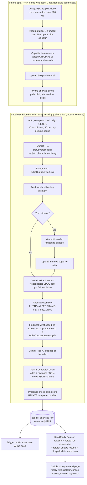
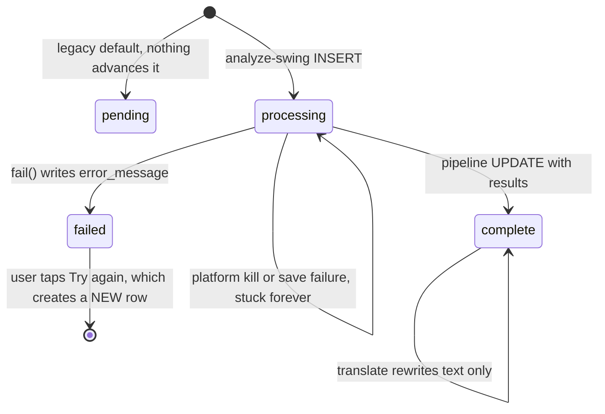
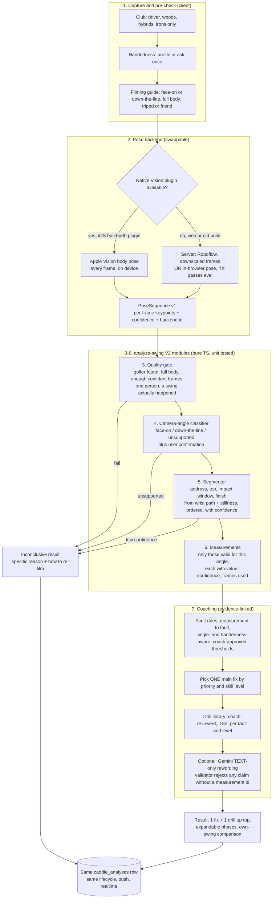

# Caddie V2 — Audit and Plan

Status: **read-only assessment, nothing implemented.** Written 2026-10-20 on branch `caddie-v2`. All Caddie code on this branch is identical to `main` (the only working-tree changes are unrelated: Founding Golfer and Ready page).

Every code claim below was re-checked against the current files. References are `path:line`, relative to the repo root. Anything that can't be known from code (billing, plan limits, retention settings, logs) is marked **UNKNOWN**.

**No accuracy has ever been measured for any part of Caddie.** This report contains no accuracy numbers. Every number labeled "target" or "threshold" is a proposal to validate, not a result.

Short names used below:

| Short | File |
|---|---|
| AS | `supabase/functions/analyze-swing/index.ts` |
| EF | `api/extract-frames.ts` |
| TV | `api/trim-video.ts` |
| RCC | `src/context/RealCaddieContext.tsx` |
| SA | `src/lib/swingAssessment.ts` |
| ASW | `src/pages/AnalyzeSwing.tsx` |
| CAD | `src/pages/CaddieAnalysisDetail.tsx` |

---

## Micky's decisions this plan is built on

- **Users:** beginners and mid-handicap (10–25) first. Advanced later. Feedback fits the golfer's skill level.
- **Output:** lead with **one** main improvement and **one** drill, plain words. Full phase breakdown is expandable.
- **Filming:** face-on and down-the-line, tripod or a friend filming. Detect the angle automatically or ask the golfer to confirm. Refuse or limit when the angle is unsuitable.
- **Shots:** full swings only (driver, woods, hybrids, irons). Chipping and putting are deferred.
- **Comparison:** against the golfer's own earlier swings. Pro references only later, with licensed material.
- **Speed:** aim for under 30 s. 1–2 min is OK if it's meaningfully more accurate. Show real progress.
- **Budget (provisional, not approval to spend):** under $0.05 per analyzed swing, $30/month total inference.
- **On-device iOS pose (Apple Vision) is acceptable** if it clearly helps, a new App Store build is OK, and the web app keeps working.
- **Infrastructure:** Supabase, on-device, or low-cost hosted. No dedicated model server yet.
- **Video length:** keep 10 s for now. Evaluate 15 s.
- **Test data:** Micky's swings and consenting friends only. Never existing user uploads without consent.
- **Ground truth:** qualified coaches via the Coach Reviewer system judge coaching correctness. Micky judges usability.
- **Engineering:** keep current Caddie until replacements are proven. Separate, testable modules. Confidence thresholds and an explicit "inconclusive" result. Keep as little video as possible. No production changes without approval.

---

## 1. Current architecture

### 1.1 End-to-end flow

### 1.2 Job lifecycle (the persisted-job design — keep it)

Evidence:

- Statuses `pending|processing|complete|failed`, default `pending`: `supabase/migrations/20260817090000_create_caddie_analyses.sql:17`.
- The function only inserts `processing` (AS:571). It moves rows to `failed` (AS:600-603) or `complete` (AS:987-1007).
- The response returns right away and the work continues in the background (AS:1042-1043).
- Client catch-up paths:
  - realtime, with a refetch every time the channel (re)subscribes (RCC:385-393)
  - refetch when the app returns to the foreground (RCC:407-409)
  - a 5 s poll while any row is processing and the page is visible (RCC:225, 430-439)
- Completion trigger, which feeds the notification and the push: first defined in `20260821110000_add_caddie_analysis_complete_notification.sql:39`, redefined in `20260916190000_extend_push_privacy_logout_round_caddie.sql:141-153`.
- **No server-side reaper exists.** A killed background run leaves `processing` forever. The code says so at `src/lib/caddieAnalysis.ts:4-15`. Only the client display treats rows older than 10 min as failed (`caddieAnalysis.ts:24-29`). The database row is never fixed.

### 1.3 Step-by-step, with references

1. **Pick.** ASW:159-211.
   - Rejects non-video files and anything over 200 MB (ASW:18, 163-170).
   - Duration read has an 8 s timeout (`src/lib/image.ts:43`). If the read fails, the clip is treated as short and **not trimmed** (ASW:172-180, 205-210).
   - Clips over 10 s open the trim selector. The window is at most 10 s (ASW:19, 314) and at least 2 s (`src/components/caddie/VideoTrimSelector.tsx:8`).
   - The file is copied into memory to avoid an iOS file-handle bug (ASW:195-201).
2. **Submit.** ASW:228-289.
   - Uploads the whole original to `caddie-media/<uid>/caddie-<uuid>.<ext>` (ASW:240-243), plus a thumbnail (ASW:247-258).
   - Calls `createAnalysis` (RCC:512-561).
   - A localStorage flag catches the app being killed mid-upload (ASW:29, 107-115, 235).
   - Uploads are deleted only on a definite 400/401/403/429 (ASW:278-285).
3. **Sync part of analyze-swing.** AS:398-590.
   - Secrets present (AS:402-412), auth (AS:416-423), media ownership (AS:443-466, helpers AS:312-328), 1 h signed URL (AS:472-477).
   - Trim window re-checked to 10.5 s or less. Anything longer is **silently ignored** (AS:485-490).
   - Cooldown (AS:494-506), daily limit (AS:508-519; also enforced in the database by `20260924140000_enforce_caddie_daily_limit.sql`), in-flight dedupe (AS:526-538), completed-row reuse (AS:547-558), insert (AS:560-590).
4. **Background pipeline.** AS:612-1040.
   - Fetch (AS:616-628), trim (AS:643-675), extract frames (AS:678-707), Roboflow coarse pass (AS:720-762), dense pass (AS:774-853).
   - Build the pose JSON (AS:855-868), call Gemini (AS:870-973), check and save (AS:975-1014), delete the untrimmed original (AS:1015-1028).
5. **Display.**
   - Detail page CAD:239-359. Replay `src/components/caddie/CaddieSwingReplay.tsx`.
   - Pose data is loaded lazily (RCC:338-358). Signed URLs last 1 h and are re-signed when they get close to expiry (`src/lib/caddieMedia.ts:15-22`, RCC:446-473).
6. **Optional extras.**
   - Translate: `supabase/functions/translate-caddie-analysis/index.ts`, text-only Gemini.
   - Share feedback text to Community (CAD:182-203).
   - Share the video: it's copied to public `community-media` only when the post is published (`caddieMedia.ts:81-87`).

---

## 2. Models, services, and how each output is produced

### 2.1 What's in use

| Piece | What it is | Evidence |
|---|---|---|
| Pose model | Roboflow **serverless Workflow** `micky-lyu/golf-swing-six-phase-analysis-1787307394301`, one HTTP call per frame | AS:61-63, 722-736 |
| Keypoints | 13 body points, COCO-style (nose, shoulders, elbows, wrists, hips, knees, ankles). **No club, ball, or hand/finger points** | `scripts/extract-golf-training-frames/ANNOTATION_GUIDE.md:33`, AS:129 |
| Model version | **UNKNOWN.** The workflow ID is fixed in code. The model version inside it is set in the Roboflow dashboard | AS:62 |
| Roboflow response | Includes a **visualization image** that the code throws away. Extra bytes and probably extra compute on every call | AS:336-338 |
| Body metrics kept | spine lean, L/R elbow, L/R knee, shoulder/hip tilt ratios, normalized wrist y, wrist velocity, metrics_unavailable | AS:350-361 |
| LLM | Google **`gemini-3.6-flash`**, v1beta REST. Files API upload, then `generateContent`. temperature 0.4, forced JSON schema. **No `thinkingConfig`, no `mediaResolution`** | AS:46-47, 885-958 |
| Translation | Same model, text only, temperature 0.2, 5 s cooldown, no daily cap | `translate-caddie-analysis/index.ts:15,17,178` |
| Frame extraction | Vercel Node function plus `ffmpeg-static`. `freezedetect` finds the moving part. `fps=` sampling, JPEG `-q:v 3`, **no downscale** | EF:45-48, 80-128, 193-203 |
| Trimming | Vercel Node plus ffmpeg, libx264 re-encode, **keeps audio (AAC)** | TV:102-121 |
| Client geometry | `SA`: hand-set 2-D angle rules on stored keypoints | SA:15-24 |
| Storage | `caddie-media` (private, owner-only). Legacy public `community-media` | `20260925090000_private_caddie_media_bucket.sql` |
| Secrets (names only) | `GEMINI_API_KEY`, `ROBOFLOW_API_KEY`, `FRAME_EXTRACT_SECRET` (Edge), `FRAME_EXTRACT_SECRET` (Vercel) | AS:402-404, EF:146, TV:67 |
| How keys travel | Gemini key in the **URL query string** (`?key=`, AS:885, 923, 941, 972). Roboflow key in the JSON body (AS:726). Frame secret as a Bearer header | — |
| Native iOS | No ML or Vision code. There is a custom-plugin precedent: `ios/App/App/AppleSignInPlugin.swift` plus `registerPlugin` in `src/lib/socialSignIn.ts` | — |

### 2.2 Swing phases

- **Gemini decides every phase.** The prompt asks for address, backswing, top, downswing, and follow-through timestamps, or null if not confident (AS:133). Impact is a time window, never an exact moment (AS:134, 227-236). Each phase gets high/medium/low confidence (AS:144-151).
- Roboflow's own phase output is **thrown away**. The hosted API forgets everything between calls, so the six-phase logic that was tested offline (stateful, about 60 fps) **can't run** on separate 8 fps calls (AS:73-79, 336-341). In production the "six-phase workflow" supplies only per-frame body points.
- **There is no code that detects phases.** The code computes exactly one motion signal, peak wrist speed, and uses it only to choose where to sample densely (AS:785-805). Roboflow's own wrist-speed value was empty on 45/45 frames of a real run, so the code recomputes it (AS:779-784).
- **No sanity checks on Gemini's phases.** Nothing checks that timestamps fall inside the analyzed frames, come in order (address < top < impact < finish), or match the wrist motion. AS:975-977 only checks that fields are present.
- The client adds a sensible trust gate:
  - only high/medium phases are used (SA:94-96)
  - the pose frame must be within 0.2 s, or one sample, of the phase time (SA:82, 108-123)
  - impact windows 0.3 s or wider are ignored (SA:89, 114)

### 2.3 Body points, angles, confidence, and coaching text

| Output | Made by | Checks today |
|---|---|---|
| Keypoint x/y plus per-point confidence | Roboflow, per frame | Kept only if `metric_reliable === true && available !== false` (AS:363-370). The annotation guide says the production model was **trained to always guess** hidden points, so its confidence doesn't reliably mean "I can't see this" (`ANNOTATION_GUIDE.md:7-27`) |
| Body metrics (angles/ratios) | Roboflow workflow | Passed through if present (AS:371-375). No range checks |
| `person_confidence` | Roboflow | Stored, **never used as a gate** (AS:379) |
| Frame "success" | HTTP 200 with `outputs[0]` | `filterRoboflowFrame` never returns null, so **a frame with zero body points still counts as a success** toward the 50 % rule (AS:363-383, 750-762) |
| Phases, camera angle | Gemini | Enum via schema only (AS:181). No consistency checks |
| Summary, strengths, work-on items with confidence, focus, drill, limitations, 5 category scores with reasons | Gemini | Presence check only (AS:975-977). Each score clamped to 0–20 and summed in code (AS:984-985). The schema **requires** every field, including exactly one focus, one drill, and all five scores (AS:254). **The model cannot answer "inconclusive."** |
| Per-segment verdicts (torso, L/R arm, hip sway, shoulder line, knees, wrists) | Client code `SA`, from 3 frames (address/top/impact) | Hand-set thresholds. In the code's own words, "NOT validated against a biomechanics dataset or labeled ground truth" (SA:15-24). Keypoint confidence 0.5 or higher (SA:63). Middle-zone values become "unknown" |
| Callouts, tips | Fixed i18n strings (see 2.4) | — |

Notes:

- Gemini gets the raw pose time series as JSON text (AS:936). It's about 50 KB on average, up to about 120 KB (RCC:43). No compact, per-phase measurements are computed for it. Asking an LLM to reason over thousands of raw numbers is the weakest link in any "evidence-based" claim.
- The score comes from Gemini at temperature 0.4, calibrated only by prompt wording (AS:137-139). Running the same video twice is likely to score differently. Completed-row reuse (AS:547-558) hides that from users.
- `SA` **ignores the camera angle and handedness**, even though every row stores `camera_angle`.

### 2.4 Hardcoded or generic feedback

- **Fixed client text per segment and status:** descriptions (`src/i18n/locales/en.ts:234-246`), callouts (en.ts:269-282), "Caddie Tip" lines (en.ts:256-263), recording tips (en.ts:264-266, used at `CaddieSwingReplay.tsx:225-227`).
- **Known wrong or contradictory text:**
  - "Try to keep your right arm more extended at the top" (en.ts:259) and the "Right elbow bent" callout (en.ts:274). A right-hander's trail (right) arm normally folds at the top. `assessArm` applies the same straight-arm rule to both arms (SA:180-199). The comment admits handedness isn't known (SA:172-179). This is **predictably wrong advice for most right-handed golfers**.
  - "Knee looked locked" (en.ts:280; rule SA:312-343) uses a 2-D knee angle. Knee bend happens mostly front-to-back, which barely shows **face-on, the angle the app recommends** (en.ts:195).
  - "Hips stayed centered ✓" / "Hips shifted off the ball" (en.ts:275-276; SA:246-278) treats any sideways hip movement between address and impact as sway. Many sound swings shift the hips toward the target by impact, so this may flag a good move as a fault. **Needs coach review, not asserted here.** The shoulder-width scale also shrinks down-the-line, which inflates the ratio.
  - The recording tips contradict each other. en.ts:195 says film face-on. en.ts:266 says film down-the-line for hips at impact.
- **Coaching text** is 100 % Gemini output per analysis. There is **no drill library**; drills are free-form LLM text (AS:205-213).
- **The detail page leads with a 0–100 score** and five sub-scores (CAD:269-288), then the summary, strengths, work-on items, focus, drill, and limitations (CAD:289-334). Micky wants the opposite: lead with one fix and one drill.
- **Failure message** is one generic string, "Caddie couldn't analyze this swing." (en.ts:205), shown for every cause (CAD:347-353, `src/pages/Caddie.tsx:143-144`).
- **Progress** is a rotating "Reading… / Tracking… / Studying… / Writing…" loop (en.ts:184-187) that isn't connected to real progress (`CaddieThinking.tsx:5-6, 22-31, 37-39`). The code says so.
- **Push text** is fixed: "Caddie finished analyzing your swing." (`20260916190000…sql:141,153`).
- **Demo data** shows "Clubface slightly open at impact" (`src/data/caddie.ts:25-26`). The real pipeline is forbidden to make clubface claims (AS:129). It's openly demo, but it misrepresents what Caddie can do.
- **The club picker includes wedges and putter** (ASW:55-61), which is outside the full-swing scope. The server accepts **any `swingType` string** and puts it into the Gemini prompt (AS:570, 933).

### 2.5 Video limits

| Limit | Value | Where |
|---|---|---|
| Upload size | 200 MB, checked on the client, by the bucket, and again on the server | ASW:18, AS:50, 627 |
| Analyzed window | 10 s, trim UI for longer clips. Server accepts up to 10.5 s, otherwise ignores the window | ASW:19, AS:54, 489-490 |
| Unknown duration | Treated as short, uploaded whole, no trim | ASW:172-180, 205-210 |
| Extract backstop | Reads only the first 11 s **when no motion window is found** (`-t 11`). When freezedetect finds a window, there's no length cap; the 150-frame limit (about 18.75 s at 8 fps) is the only guard | EF:33, 194-201; AS:83, 701-703 |
| Trim backstop | 15 s | TV:33, 84 |
| Frame rate | 8 fps coarse, 20 fps over ±0.5 s around peak wrist speed | AS:79, 95-97 |
| Roboflow | 8 calls at a time, 2 attempts per frame, at least 50 % HTTP success | AS:80-82 |
| Gemini file-ready wait | 6 × 2 s = **12 s max** | AS:52-53, 921-928 |
| Edge budget | Comment says 400 s on the Pro plan (AS:57, 80). Observed runs: 65 s (`LAUNCH_CHECKLIST.md:185`), 87.5 s (`DEVELOPMENT_STATUS.md:445`), about 3.5 min for a 52 MB .mov (`caddieAnalysis.ts:18`) | — |
| Edge memory | Whole video (up to 200 MB) held in memory, plus the trimmed copy | AS:622, 654 |
| What Gemini sees | The trimmed clip, **or the whole original** when there's no trim (possibly minutes long if the duration read failed) | AS:639, 669, 909 |

---

## 3. Technical weaknesses, ranked (privacy and security first)

### Privacy and security

| # | Severity | Weakness | Evidence | Impact |
|---|---|---|---|---|
| P1 | **High** | **Videos are kept forever, and a user can't delete one analysis.** The client delete policy was dropped to protect the daily limit. No Caddie screen offers delete. Untrimmed originals (up to 200 MB) stay. Only account deletion purges them | `20260924140000…sql:18,33`; delete-account `index.ts:191-194,223` | Conflicts with "minimize video retention". Storage keeps growing |
| P2 | **High** | **Legacy public media still reachable by URL.** 98 objects (435 MB) for 49 direct-upload rows, plus 76 orphaned `caddie-*` objects (602 MB). Not listable, but fetchable by anyone who has the URL | `DEVELOPMENT_STATUS.md:615`, `LAUNCH_CHECKLIST.md:85` | Old private swing videos are effectively public by link. Fix needs Micky's approval |
| P3 | Medium | **Full video, including audio, goes to Google.** Trimmed copies keep the AAC audio track. Untrimmed originals are sent as-is. Deleting the Gemini file is fire-and-forget and errors are ignored, while the Privacy Policy says it's "deleted from Google's side right after" | TV:116-117, AS:909, AS:970-973, `src/pages/PrivacyPolicy.tsx:176-178` | Voices and bystanders shared with no coaching benefit. The policy wording may not match reality. Whether the Gemini project is on paid terms (no training on data) is **UNKNOWN** |
| P4 | Medium | **Full-resolution frames go to Roboflow.** Whether Roboflow stores them, and whether the workflow has dataset or active-learning blocks, is **UNKNOWN** | AS:726, EF:202 | Possible third-party retention of user images |
| P5 | Medium | **Result columns can be forged by the owner.** `update_own` allows any column and `insert_own` allows any status. A user can set their own score/status/analysis, which triggers a self-push and skews admin stats. This is built in: the pipeline writes results with the user's own JWT | `20260817090000…sql:48-55`; AS:34-41, 987 | Own-data integrity only, not a cross-user leak. Fixing it requires service-role writes (a security decision) |
| P6 | Low | Gemini key in the URL query string | AS:885, 923, 941, 972 | Can show up in proxy or egress logs. Use the `x-goog-api-key` header |
| P7 | Low | Raw provider/ffmpeg error text (up to 500 chars) stored in `error_message`, readable by the owner, and logged | AS:595, 652, 692, 761, 898, 913, 961; RCC:230 | Contradicts the code's own "never a raw provider error body" note (AS:268-269) |
| P8 | Low | Vercel URL allowlist accepts **any** `*.supabase.co` project. The secret comparison isn't constant-time | EF:137, 148; TV:58, 69 | Only matters if `FRAME_EXTRACT_SECRET` leaks |
| P9 | Low | `swingType` isn't validated and goes into the prompt | AS:570, 933 | Prompt injection limited to the user's own analysis, plus wasted tokens |
| P10 | Low | Trimmed-copy orphans after a late failure (AS:657-661). Ambiguous client failures keep uploads (ASW:273-285). No storage sweep (`DEVELOPMENT_STATUS.md:608`, "Later: unused-Storage sweep") | — | Private files with nothing pointing to them |

### Correctness and reliability

| # | Severity | Weakness | Evidence | Impact |
|---|---|---|---|---|
| C1 | **Critical** | **Confident feedback with no validated basis, and no way to say "inconclusive."** Phases, score, and all coaching text come from one unvalidated LLM call. The schema forces a full verdict. Nothing checks that a golfer, or a swing, is even in the video | AS:119-141, 241-254, 363-383, 760 | Root of most accuracy risk. Directly against "never present speculation as fact" |
| C2 | **High** | **Deterministic wrong coaching from client rules:** trail-arm, face-on knees, possibly hip "sway" (section 2.4). Not aware of camera angle or handedness | SA:180-199, 246-278, 312-343; en.ts:259, 274-276, 280 | Same wrong tip every time for many right-handed golfers |
| C3 | High | **Rows stuck forever, no reaper.** Two live examples: `449a5520` (`pending`, which no code path advances, so it shows "Analyzing…" forever per `Caddie.tsx:145-148` and CAD:354-358) and `212bf24f` (`processing` since 2026-09-18). **Hypothesis, not verified:** every post-response write uses the caller's JWT (AS:417, 600, 658, 987). If that token expires during a 1.5–3.5 min run, both the save and `fail()` fail, leaving `processing` | `caddieAnalysis.ts:4-15, 27`; `LAUNCH_CHECKLIST.md:84` | Spinner never ends. Needs logs for `212bf24f` |
| C4 | High | **Memory and time headroom on big files.** The whole video is buffered in the Edge Function. It's fetched again by trim and by extract (twice), then uploaded to Gemini. The Gemini ready-wait is only 12 s | AS:619-622, 645, 680, 811, 902-910, 52-53 | Large or long clips are near platform limits. Limits are **UNKNOWN** |
| C5 | High | **Unbounded Gemini input when the duration can't be read.** Pose covers at most the first 11 s or the detected motion window, but Gemini gets the whole original | ASW:172-180; EF:194-201; AS:909 | Cost blow-up, and phases can fall outside pose coverage |
| C6 | High | **Retry drops the trim window.** Retry sends path, thumbnail, and club but no start/end. A failed row still points at the untrimmed original | CAD:139-158; AS:995 | Retry analyzes the wrong part of the video |
| C7 | High | **The "success ratio" counts HTTP replies, not detections** | AS:750-762 | A clip with no visible golfer can reach Gemini with empty pose data |
| C8 | Medium | Phases are LLM-only with no ordering, range, or motion checks | AS:975-977 | The replay and every SA verdict depend on them |
| C9 | Medium | Score varies between runs and isn't calibrated | AS:953, 137-139 | Before/after comparisons would mostly measure noise |
| C10 | Medium | Raw coordinates (about 15–45k tokens) go to the LLM instead of compact, confidence-tagged measurements | AS:936; RCC:43 | Cost and weak evidence links |
| C11 | Medium | **Cost telemetry gaps.** `devLog` probably doesn't run in production (AS:270). `totalRoboflowCalls` adds dense *successes*, not requests or retries (AS:1035). Gemini `usageMetadata` isn't stored | — | Real cost per swing can't be measured |
| C12 | Medium | Full-resolution frames plus a visualization image per Roboflow reply, and every frame as base64 JSON through Vercel | EF:202, 205-223; AS:336-338 | Latency, bandwidth, and a possible response-size limit (**UNKNOWN**) |
| C13 | Low | Translation overwrites the original text, and items that weren't assessed get "medium" confidence | `translate-caddie-analysis/index.ts:203` | Invented confidence label |
| C14 | Low | Doc drift: `DEVELOPMENT_STATUS.md:5` still says "Last updated 2026-09-25". AS:79 points to "DEVELOPMENT_STATUS for the cost math", but that section doesn't exist | — | Misleading for future sessions |

---

## 4. Roboflow and Gemini usage and cost per swing

**Everything here is derived from code, not billing data.** Per-unit prices and plan details are **UNKNOWN** until Micky checks the dashboards. Prices below are labeled **ASSUMPTION** and only show the shape of the math.

### 4.1 Calls and tokens per swing (from code)

**Roboflow (one workflow run per frame):**

| Part | Formula | Typical | Range |
|---|---|---|---|
| Coarse pass | motion-window seconds × 8 | 45 (one logged production run, AS:714) | about 12–88 (1.5 s min window, EF:48; 11 s backstop) |
| Dense pass | about 1.0 s × 20 fps, only if the coarse window is 2 s or longer | about 20–21 | 0–21 |
| Retries | +1 call per failed frame | 0 | up to doubling |
| **Total** | | **about 65 calls** | about 12–110 without retries; **worst case about 218** |

Each call uploads a full-resolution JPEG and gets back a visualization image (AS:336-338). Whether Roboflow bills per workflow run, per model step inside it, or per compute-second is **UNKNOWN**.

**Gemini (one call per swing, plus optional translation):**

| Input part | Estimate | Basis |
|---|---|---|
| Video, about 10 s | about 1k–3k tokens | Google's documented per-second sampling for video plus audio. Exact rate for `gemini-3.6-flash` at default resolution is **UNKNOWN** (no `mediaResolution` set, AS:952-956) |
| TRUSTED_POSE_DATA | about 15k–20k tokens on average, up to about 45k | 50 KB average, 120 KB max (RCC:43), at roughly 2.5–3.5 characters per token for numeric JSON |
| System prompt plus schema | about 2k tokens | AS:119-256 |
| **Input total** | **about 18k–25k tokens** | |
| Output | about 1k–2k JSON tokens, **plus thinking tokens (UNKNOWN)** | No `thinkingConfig`, so the model default applies |

### 4.2 Dollar estimate (ASSUMPTIONS clearly marked)

| Item | Assumption | Per swing |
|---|---|---|
| Gemini input | ASSUMPTION: $0.30–$0.50 per 1M tokens | about $0.005–$0.013 |
| Gemini output plus thinking | ASSUMPTION: $2.50–$3.00 per 1M, 1k–6k tokens | about $0.003–$0.018 |
| **Gemini subtotal** | | **about $0.01–$0.03** |
| Roboflow | **UNKNOWN** $/run × about 65 runs | **UNKNOWN** |
| Translation (optional) | text only, about 3–5k tokens | under $0.01 |
| Vercel ffmpeg, Supabase egress | Probably inside fixed plans. Note that one swing pulls the video from Storage 3–4 times (AS:619, 645, 680, 811) | **UNKNOWN** marginal |

**What this means against the targets:**

- **$0.05 per swing:** if Gemini costs about $0.01–$0.03, Roboflow has about $0.02–$0.04 left for about 65 calls. That's a **break-even of roughly $0.0003–$0.0006 per Roboflow run**. Micky can compare that one number with the Roboflow plan to see whether today's pipeline fits.
- **$30 per month:** at $0.05 per swing, that's about 600 swings a month across all users. **The current per-user limit of 30 per day allows one user about 900 a month** (AS:49). Today there's no global spending guard, so the monthly target can't be enforced. Adding one is a server change and needs approval.
- **Measuring real cost first:** store Gemini's `usageMetadata` and the true Roboflow request and retry counts per row (C11).
- **Historical call counts** can be rebuilt with a read-only SQL query on `roboflow_analysis_json.video.frames_requested` and `dense_impact_window_frames_analyzed` (AS:857-862). That's a production read, so it needs approval.

### 4.3 Where V2 could land (estimates to verify, not promises)

| Path | Pose cost | Coaching cost | Rough total |
|---|---|---|---|
| iOS on-device Vision plus fixed text templates | $0 | $0 | **about $0** in inference |
| iOS Vision plus Gemini **text-only** on compact measurements (about 3–5k in, under 1k out) | $0 | about $0.002–$0.006 (same ASSUMED prices) | **under $0.01** |
| Web fallback with Roboflow, downscaled frames, coarse pass only | **UNKNOWN** × about 45 | as above | depends on the Roboflow rate |
| Web fallback with in-browser pose (e.g., MediaPipe) | $0 (user's device) | as above | under $0.01, **but browser performance and accuracy are unproven** |

---

## 5. Accuracy limitations (stated plainly)

- **No accuracy, consistency, or coaching-correctness measurement exists for any part of Caddie.** There is no labeled dataset, no evaluation script, and no test runner (`package.json:6-15` has no `test` script; no media or eval files in the repo).
- What exists is **operational evidence only**:
  - 57 analyses completed with 0 failures in 30 days (`LAUNCH_CHECKLIST.md:76,80`)
  - end-to-end times of 65 s and 87.5 s, as cited in section 2.5
  - These show that the pipeline runs. They say nothing about whether its feedback is right.
- The "validated six-phase workflow" was validated in a different setup (stateful, about 60 fps) from production (stateless, 8 fps) (AS:73-79). Where that validation lives, and what it showed, is **UNKNOWN** (open question 9).
- The production pose model was trained to guess hidden points (`ANNOTATION_GUIDE.md:14-20`), so its confidence values may be high exactly when it's wrong.
- `SA` thresholds are self-described as unvalidated (SA:15-24) and have known false-positive patterns (C2).
- The Gemini score has never been checked for repeatability or against coaches.

---

## 6. What's reliable enough to keep

| Keep | Why |
|---|---|
| **Persisted server-side job** (row as the source of truth, `waitUntil`, realtime plus resubscribe/resume refetch plus visible poll, completion trigger and push) | Frozen area. Proven in production. V2 must plug into it, not replace it |
| Private `caddie-media`, paths stored instead of URLs, 1 h signed URLs with refresh, copy-on-publish sharing, post-delete privatization (`caddieMedia.ts:112-164`), delete-account purge | Sound privacy design, device-verified (`LAUNCH_CHECKLIST.md:53`) |
| Media ownership checks (AS:312-328), Vercel allowlist, database daily limit with advisory lock, cooldown, dedupe, idempotent reuse | Security and cost guards that work |
| Honest failure: rows become `failed` instead of being deleted, and real accounts never get invented results | Matches the V2 principles |
| ffmpeg services (freezedetect motion window, precise trim) | Cheap and modular. Add downscaling and audio stripping |
| `SA`'s *trust mechanism* (confidence floor, phase-confidence gate, frame-offset limit, impact-width limit, "unknown" middle zone) | The mechanism is right. The rules inside need validation |
| Replay UI, skeleton overlay, callout layout | Good presentation layer for V2 measurements |
| Safety wording in the prompt (no club/ball metrics, no injuries, no claim to be a pro) | AS:126-131. Carry it into V2 coaching rules |
| Profile `handicap` and `skill_level` already exist | `20260811163457_create_profiles.sql:27`, `20260812180000…sql:11`. Personalizing by skill needs **no schema change** |

**Weak, to replace or put behind validation:** Gemini-chosen phases, Gemini score, the "success ratio," the forced full verdict, SA rules that ignore angle and handedness, and raw coordinates as LLM input.

---

## 7. Recommended V2 architecture

### 7.1 Principles

1. **Separate, testable modules** with typed inputs and outputs. Each records its own version and a confidence value.
2. **Code does the measuring; language only phrases.** Phases, angles, and faults are computed by deterministic, versioned code. An LLM may only reword findings already backed by measurements, and a validator rejects any claim without a measurement ID.
3. **Every module can answer "inconclusive"** with a specific reason. The final result can be "inconclusive" with a fix ("film from the side, full body in frame").
4. **Same persisted-job lifecycle.** V2 results go into the same `caddie_analyses` row (e.g., under `analysis_json.v2`, or a new column after approval). Background work and resume behavior stay as they are.
5. **One pose contract, several backends.** Apple Vision (iOS), Roboflow (web, today), or an in-browser model all output the same `PoseSequence` with a `backend` and `backendVersion` field, so measurements can be compared and calibrated per backend.

### 7.2 Pipeline

### 7.3 Improve the existing piece, or replace it — per module

| Module | Improve existing | Replace | Recommendation |
|---|---|---|---|
| **Capture / angle check** | Keep the trim UI. Add a filming checklist and angle confirmation | — | **Improve.** Cheap, client-only, ships with a web deploy |
| **Quality gate** | Today it's an HTTP ratio | New module: person found, required keypoints present, framing, a motion event | **Replace** (new pure function) |
| **Pose, iOS** | Keep Roboflow, downscale frames to about 640–720 px, remove the visualization block, fewer calls | **Apple Vision** body pose on device. Free and private, can process every frame. Needs a native plugin (precedent: `AppleSignInPlugin.swift`) and an App Store build | **Prototype Vision and benchmark it against Roboflow on the same labeled clips.** Adopt only if it's at least as good on golf-specific frames (fast downswing blur, hands crossing). Not proven today |
| **Pose, web** | Roboflow, downscaled, coarse pass only | In-browser model (e.g., MediaPipe Pose Landmarker via WASM) | **Keep Roboflow as the web fallback.** Evaluate the browser model as an option. Feature-detect the native plugin the same way `socialSignIn.ts` does |
| **Camera angle** | Gemini's enum | Deterministic classifier (shoulder/hip width vs torso height, left-right overlap) plus user confirmation | **Replace**, keep the user confirmation step |
| **Segmentation** | Gemini timestamps plus sanity checks | Deterministic segmenter on the wrist path, stillness, and velocity reversal. Works best on every-frame pose | **Replace.** Add V1 sanity checks first as a cheap stopgap |
| **Measurements** | `SA` geometry | A server-side measurement module, angle-aware, with per-measurement confidence, stored in the row | **Improve and move `SA` logic** into a shared pure module, fix lead/trail, restrict by angle |
| **Coaching logic** | Gemini writes everything | Rules plus a coach-reviewed drill library. Gemini text-only optional for wording | **Replace the decision**, keep the LLM (if any) for wording only |
| **Score 0–100** | Gemini | Drop it, or rebuild later from validated measurements | **Hide behind a flag** in V2 until validated (C9). Product decision for Micky |
| **Comparison** | — | Same golfer, same angle, same club, same pose backend. Compare measurements, not scores | **New**, Milestone 3 |
| **Video retention** | Store original or trimmed copy forever | Store one downscaled, audio-free analysis clip. Delete the original after processing. Add per-analysis delete (a server RPC that keeps daily-limit counting honest) | **Improve.** The delete flow needs DB approval |

### 7.4 Where the modules live

- Pure, dependency-free TypeScript modules that both the Edge Function (Deno) and the web app (for replay overlays) can import. `supabase/functions/_shared/` is the usual Supabase convention, but none exists in this repo yet.
- The first engineering task must confirm that Vite and the Supabase bundler can both import from one location before committing to it.

### 7.5 Native and web parity

- Capacitor loads the live web app (`ios/App/App/capacitor.config.json:6`), so **all JS and UI changes reach iOS through a web deploy**. Only the Vision plugin needs an App Store build.
- Older builds without the plugin automatically fall back to the web pose path.
- Results from different backends must store `backend` and be calibrated separately. Own-swing comparisons should only compare analyses from the same backend until cross-backend agreement is measured.

---

## 8. Evaluation framework and dataset

### 8.1 Dataset (consented only)

- **Sources:** Micky's swings and friends who consent in writing. **Never existing user uploads** without explicit consent.
- **Starting size (proposal):** 60–100 clips, stratified as follows:
  - **Angle:** face-on and down-the-line, plus about 10 % deliberately bad angles (behind, steep, partial body).
  - **Club:** driver, a hybrid or wood, a mid iron.
  - **Golfer:** beginner and mid-handicap, both handedness if possible.
  - **Filming:** tripod and handheld by a friend.
  - **Light:** good daylight, backlit, dusk or indoor net.
  - **Trouble cases:** baggy clothing, second person in frame, no swing (practice waggle only), very short clip.
  - **Frame rate:** 30, 60, and 120/240 fps slow-motion where available.
- **Consent record per clip:** who, date, permitted uses (evaluation only), and a retention date.
- **Storage:**
  - For Milestone 1, keep clips **outside the production app** (Micky's own private storage) and share them with coaches via private links. No production change needed.
  - A private `caddie-eval` bucket and a labels table, with coach/admin-only RLS in the same migration, are a Milestone 2 option. **Needs DB approval.**

### 8.2 Labeling through coaches

- **Finding:** the current Coach Reviewer system **can't be used for this as it is**.
  - `coach_reviews` only attaches to **public Swing Posts** (`community_posts.type = 'swing'`).
  - It holds only free-text fields (strengths, improvements, suggested drill, comments).
  - **Every authenticated user can read every review** (`20260818040000_create_coach_reviewer_system.sql:88-118`).
  - Private eval clips would have to become public posts, and the labels wouldn't be structured.
- What can be reused: the **reviewer role and invite system** (`user_roles`, `private.has_role`) to decide who is a qualified labeler.
- **Milestone 1:** a structured labeling sheet (spreadsheet or form) filled in by coaches who hold the `coach_reviewer` role.
- **Milestone 2 (needs DB approval):** a private labeling screen backed by a new table.

**Fields per clip:**

| Label | Format |
|---|---|
| Camera angle | face-on / down-the-line / unsuitable |
| Handedness | right / left |
| Phase times | address, top, impact (frame number), finish. "Can't tell" allowed |
| Key-frame keypoints | On address, top, and impact frames only, a subset of clips (about 20): 13 points, **"not visible" allowed** (same rule as `ANNOTATION_GUIDE.md`) |
| Faults present | From a fixed list (e.g., early extension, sway, loss of posture, over-the-top tendency, reverse pivot, poor balance at finish, chicken wing): yes / no / can't tell from this angle |
| Main improvement | One choice from the list, plus a free-text reason |
| Suitable drill | From the draft drill library, or free text |
| Skill estimate | beginner / mid / advanced |

**Protocol:**

1. Two coaches per clip where possible. Report agreement:
   - phase-time difference
   - Cohen's kappa for faults
   - same main improvement, yes/no
2. Coaches label **before** seeing Caddie's output (blind pass).
3. In a second pass, they rate Caddie's output: correct / partly / wrong / harmful.
4. Clips where coaches disagree are marked ambiguous and scored separately.
5. Micky rates usability only (clarity, tone, would-I-act-on-this). He doesn't judge coaching correctness.

### 8.3 Benchmarks (proposed thresholds, to validate, not results)

| Area | Metric | Proposed starting threshold |
|---|---|---|
| Phase accuracy | Error vs coach label for address/top/finish. Share of clips where the impact window contains the labeled impact frame. Phase order always correct | about 2 frames at 30 fps for 90 % of clear clips; impact window contains impact 90 %; order 100 % |
| Landmark reliability | PCK@0.1 (share of keypoints within 10 % of torso length of the label) on key frames. **Honest abstention**: share of "not visible" labels the model scores low-confidence | PCK 90 % or more for shoulders/hips, 80 % or more for wrists; abstention 80 % or more |
| Angle stability | Frame-to-frame spread at still address. Same golfer, two consecutive swings. Error vs angles measured on coach-labeled frames | spread ≤ 3°; swing-to-swing ≤ 5° on clear clips; error ≤ 5° |
| Camera-angle detection | Accuracy on face-on / down-the-line. Recall of "unsuitable" | 95 % or more; unsuitable recall 90 % or more |
| Occlusion and lighting | All metrics above, per condition group. **Confident-but-wrong rate** in bad conditions | Must abstain rather than err: confident-wrong 5 % or less |
| Coaching correctness | Coach rates the main improvement and drill | correct or partly correct 80 % or more; **harmful 0 %**; wrong 10 % or less |
| False-positive faults | Per-fault precision vs coach labels. False faults on clean swings | precision 85 % or more; at most 1 false fault per 10 clean clips |
| Inconclusive rate | Share of well-filmed clips returned as inconclusive | 20 % or less (keeps Caddie useful) |
| Latency | Tap to result, p50 / p90, per path (iOS Vision, web) | p50 ≤ 30 s, p90 ≤ 60 s |
| Cost | Measured from `usageMetadata` and Roboflow counts | ≤ $0.05 per swing |

### 8.4 Harness design

- A local CLI under `scripts/caddie-eval/` reads three things:
  - a manifest of consented clips
  - coach labels
  - **cached** pose output per backend, so re-scoring never re-spends API credits
- It runs the V2 modules (and, once paid for, a frozen copy of V1 outputs) and writes a versioned results table.
- Every run records each module's version, so before/after comparisons are reproducible.
- Running V1 or Roboflow over the dataset costs real credits (about 65 Roboflow runs plus one Gemini call per clip). **That spend needs Micky's approval.**

---

## 9. Three milestones

### Milestone 1: measure before changing (no production impact)

- Pose contract (`PoseSequence`), plus V2 modules as pure TS with unit tests on synthetic and recorded sequences:
  - quality gate
  - camera-angle classifier
  - segmenter
  - first measurements
- Evaluation harness (8.4). Consented dataset collected. Coach labeling sheet run.
- **Baseline V1** on the dataset. Needs spend approval for about 60–100 runs.
- **Apple Vision prototype:** a throwaway Swift harness on Micky's Mac/iPhone that writes `PoseSequence` JSON for the same clips. Not shipped.
- Small V1 fixes, each **needing approval to deploy**:
  - hide the trail-arm callout and the face-on knee callout
  - send the trim window on retry
  - add phase-order and range sanity checks
  - narrow the club picker to full swings
- **Exit:** baseline numbers per benchmark, and a go/no-go per module (Vision vs Roboflow included).

### Milestone 2: V2 server pipeline in shadow mode

- `analyze-swing` runs V2 modules **alongside** V1 for allow-listed test accounts only. The V2 output is stored but not shown to normal users.
  - Store under `analysis_json.v2`, or a new column. **A new column needs a migration.**
  - Note `LAUNCH_CHECKLIST.md:245`: local and production migration versions don't match, so `supabase db push` must not be used. Apply migrations the way current ones are applied.
- Inconclusive result UX. Coach-reviewed drill library (6 languages). Text that adapts to skill level, using `profiles.skill_level` / `handicap`.
- Experiment: Gemini **text-only** on measurements vs fixed templates. Removes the video upload to Google entirely if it's good enough.
- Telemetry: real Roboflow request and retry counts, Gemini `usageMetadata`, time per stage. Server reaper for stuck rows. **Needs approval** (it's a scheduled job or SQL function).
- **Exit:** V2 meets or beats V1 on every benchmark and meets the thresholds Micky accepts.

### Milestone 3: iOS on-device pose, new result screen, rollout

- Native Vision Capacitor plugin (App Store build), feature-detected, web fallback kept.
- Real stage-based progress (uploading, finding your swing, measuring, writing tips) driven by row updates.
- New result screen: one fix plus one drill up top, expandable phases, own-swing comparison (same angle, club, and backend).
- Retention: one downscaled, audio-free clip kept, original deleted. Per-analysis delete. Global monthly budget guard. **Needs DB and production approval.**
- Gradual rollout behind a flag. V1 stays available until V2 is validated in production.

---

## 10. Risks and tradeoffs

- **Vision vs Roboflow.**
  - Vision is free, on-device, private, and can process every frame. Roboflow's model is golf-trained.
  - General-purpose pose models may struggle with motion blur in the downswing and with crossed hands. Vision has more joints, different names, and different biases.
  - **Pick on measured results, not assumptions.** Keep the backend ID with every result.
- **Web/iOS parity.**
  - Two pose backends mean two calibrations. Comparisons and thresholds must be per backend until agreement is measured.
  - A web user and an iOS user filming the same swing could get different verdicts, and that has to be measured.
- **10 s vs 15 s.**
  - Cost and time scale with the **motion window**, not the clip length, because freezedetect trims still footage (EF:80-128). With on-device pose, a longer clip costs nothing extra.
  - 15 s mainly helps tripod users who start recording, then walk to the ball.
  - The risk is memory and upload size (C4) and a mismatch with server caps (AS:54 is 10 s, EF:33 is 11 s, TV:33 is 15 s).
  - Recommendation: in Milestone 1, measure how often real clips are 10–15 s long and whether the motion window still lands at 6 s or less. Only then raise the **source** limit, keeping the **analyzed** window short.
- **LLM vs templates.** Templates are predictable, free, and easy to validate, but feel repetitive. LLM wording reads better but can slip in unsupported claims. Middle path: a validator that requires a measurement ID per claim, plus fallback to templates.
- **Coach bottleneck.** Labeling is slow and coaches will disagree. Plan for inter-coach agreement and ambiguous clips. A small dataset can be over-fitted, so keep a held-out set.
- **Handedness.** Not captured today (SA:172-179). Lead/trail coaching is impossible without it. Ask once and store it (profile field means a migration), or infer it and confirm.
- **Frozen persisted-job architecture.** Every V2 change must keep the row as the source of truth, keep `waitUntil`, and keep the client's catch-up paths. No in-memory job state.
- **2-D limits.** Single-camera 2-D pose can't measure true rotation or depth. Some faults are only judgeable from one angle. V2 must restrict claims by angle, not just warn about it.
- **Score removal.** Hiding the 0–100 score may feel like a downgrade to current users. It's a product call for Micky.

---

## 11. Do these first

### The three highest-impact improvements

1. **Build the evaluation harness and the consented, coach-labeled dataset.** Nothing else can be judged without it. No production change. Spend approval is needed only to run V1 or Roboflow over the clips.
2. **Add a quality gate and an explicit "inconclusive" result**, and restrict claims by camera angle. This stops confident feedback on clips with no golfer, bad framing, or an unsupported angle (C1, C7). Shadow-mode first, then shown to users. Production deploy and possibly a schema change need approval.
3. **Remove deterministic wrong coaching now.** Hide or fix the trail-arm and face-on knee callouts and tips, flag hip "sway" for coach review, fix the contradictory filming tips, and send the trim window on retry (C2, C6). This is client-only and ships through a web deploy, but **the deploy needs approval**.

Close behind: a stuck-row reaper (C3, needs DB/production approval) and cost telemetry (C11, Edge Function deploy needs approval).

### Recommended first engineering task (branch `caddie-v2`, no production impact)

**"Pose contract and V2 module skeleton with tests":**

> **Status (2026-10-20): partly done on `caddie-v2`, not pushed, not wired into anything.** Done: Vitest 5.0.3 plus `npm test` (`9267264`); `src/lib/caddie/v2/` with the `PoseSequence` contract and V1 Roboflow adapter (`9267264`), quality gate (`37675c7`), phase-order check for V1 Gemini phases (`88188d3`), and camera-angle heuristic (`657b1d0`); 53 unit tests on synthetic fixtures. All thresholds are provisional placeholders until the coach-labeled eval set exists. Still open: proving the Supabase Edge bundler can import `src/lib/caddie/v2/` (the modules are written Deno-portable and import cleanly under Node's native TS stripping, but no Deno or Supabase CLI was available to test); the segmenter and `Measurement` producer (type only, for now).

- **Shared location.** Pick one location that both the Vite app and the Supabase bundler can import, and prove it with a trivial import.
- **Types.** Define `PoseSequence`, `QualityGateResult`, `CameraAngleResult`, `SwingSegments`, and `Measurement`, each with confidence and an `inconclusiveReason`.
- **Pure functions:**
  - **Quality gate.** Fails a frame with no keypoints or a low `person_confidence`, which fixes the "zero keypoints counts as success" gap (C7).
  - **Phase-order sanity check.** Can also be applied to V1 Gemini phases (C8).
  - **First camera-angle heuristic.**
- **Adapter.** Converts today's `roboflow_analysis_json` shape into `PoseSequence`, so V1 data can be replayed for free later.
- **Tests.** Add a test runner (e.g., Vitest as a dev dependency) and unit tests on synthetic sequences.
- **Checks.** `npx tsc -b`, `npm run build`, `npm run lint`.
- **Not touched:** `analyze-swing`, the database, any provider, any deploy.

### Approval needed vs not

| Item | Needs approval? |
|---|---|
| Harness, modules, tests on the `caddie-v2` branch | No (local branch work; ask before pushing) |
| Running V1, Roboflow, or Gemini on the eval set | **Yes, spend** |
| Read-only SQL on production for historical counts and timings | **Yes, production read** |
| SA/UI hotfixes and the retry fix | **Yes, web deploy** |
| Shadow-mode V2 in `analyze-swing`, telemetry | **Yes, Edge deploy** |
| New columns, eval tables, reaper, budget guard, per-analysis delete | **Yes, migration with RLS** |
| Vision plugin | **Yes, App Store build** |
| Legacy public-media backfill and orphan sweep | **Yes, already pending** (`LAUNCH_CHECKLIST.md:85`) |

---

## 12. Open questions only Micky can answer (dashboards and logs)

1. **Gemini billing.**
   - ~~Is the project on a paid tier?~~ **Answered 2026-10-20 (Micky's AI Studio screenshot):** Paid Tier 1, prepaid credits (HK$500 added 2026-08-21, HK$486.73 left; both "GolfMe" and "My First Project" on that billing account). Still to confirm: the Caddie key's project. Auto-reload left off for now (Google won't accept a threshold below the current balance); a Google Cloud monthly budget alert was set 2026-10-20.
   - What is the actual price per 1M input and output tokens for `gemini-3.6-flash`?
   - What has total monthly spend been so far?
   - Are thinking tokens being billed by default?
2. **Roboflow plan.**
   - What is the billing unit (per workflow run, per model step, or per compute-second) and the price or credit rate?
   - What are the monthly credits and the cap? A past outage was `credit_cap_exceeded` (AS:714-715).
   - How many runs and how many credits were used last month?
3. **Roboflow data.**
   - Does the workflow store inference images, or include dataset or active-learning blocks?
   - What is the retention setting?
   - Can the visualization output be removed (AS:336-338)?
   - Which model version is inside the workflow?
4. **Logs for stuck rows.**
   - Edge Function logs for `212bf24f` (2026-09-18): was there a "save after successful analysis failed" or "failed to mark row as failed" line (AS:605, 1012), a JWT-expired error, a timeout, or nothing at all (a platform kill)?
   - Is it OK to clean up `449a5520` (`pending`) and `212bf24f`?
5. **Supabase limits.**
   - What are the Edge Function wall-clock and memory limits on the current plan, and what happens to `waitUntil` when they're exceeded?
   - Is `SUPABASE_ENV` or `ENVIRONMENT` set to `production`? That decides whether `devLog` runs (AS:270).
   - What is the Storage egress quota and current usage?
6. **Vercel.**
   - What are the memory and duration settings for `extract-frames` and `trim-video`, and is Fluid compute on?
   - What is the largest response size seen vs the plan's response limit?
7. **Approval for read-only production SQL** on `caddie_analyses`, to get:
   - frame and dense counts
   - share of frames with empty keypoints
   - `camera_angle` mix
   - score spread
   - processing time (`updated_at - created_at`)
   - clip lengths
8. **Existing footage.** Is there already a consented clip set (e.g., the `raw-swings` folder that `scripts/extract-golf-training-frames` expects)?
9. **Earlier validation.** Where is the offline validation of the six-phase workflow (AS:8-9, 59-60, 74-77), and what did it measure?
10. **Coaches.** How many qualified coaches with the reviewer role are available, and how many clips can each label per week?
